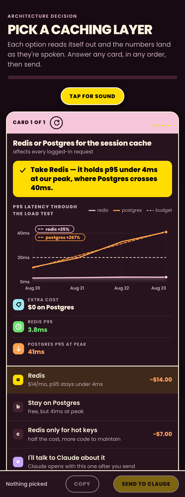

# fancyaskuserquestion

A Claude Code plugin that replaces a multiple-choice prompt with something you
can actually decide from: a narrated, animated card deck you swipe through on
your phone, and your answers come straight back to the session.

A plain list of options puts the choices in front of you and leaves the
evidence somewhere else — in the scrollback, in a file, in the model's head.
A deck puts both in the same place. Each card opens with the call and its
reason, then a chart, then the numbers, then what you can do about it, read
aloud in that order while the visuals land on the beat.



## What a card does

- **Narration** in whatever voice you pick, generated locally with macOS `say`.
- **Facts that land as they're spoken** — the builder speaks the script one
  sentence at a time, so it knows exactly when each number is mentioned.
- **A chart that survives real data.** It scales to its line series rather than
  to the wildest point, so one freak sale can't flatten a $40 trend into a
  wire; outliers get pinned to the top edge and named. Real dates on the axis,
  a dashed least-squares trend per series with its percentage in the corner.
- **Trendlines that draw on cue**, left to right, on the sentence that mentions
  them.
- **Values that count up** as they arrive.
- **Two escape hatches on every card**: *I'll talk to Claude about it*, and
  *Other — say it in your own words*, which opens a text box. Both come back
  with your picks.
- **Answers return by themselves.** Tap Send and the page republishes with your
  choices baked in, which reaches the session that built it. Or copy the key
  line (`1a 2c 3b`) and paste it in chat.

Nothing waits on the audio: if your phone blocks autoplay, every reveal fires
on a timer instead. Everything collapses to plain visibility under
`prefers-reduced-motion`.

## Install

```bash
claude plugin marketplace add nathan-hekman/fancyaskuserquestion
claude plugin install fancyaskuserquestion@fancyaskuserquestion
```

Or clone it and point Claude Code at the directory.

Requires macOS `say` and `ffmpeg` for narration (`brew install ffmpeg`).
Without them the deck builds silently and everything else still works.

## Use

Mostly you don't. Once installed, Claude reaches for a deck on its own when a
decision has real options and real evidence behind it. To force one:

```
/faq should we move the session cache to Redis?
```

To build one yourself:

```bash
python3 scripts/build_deck.py examples/example-spec.json --out ./deck
```

Then publish the HTML as an Artifact with `capabilities: {"artifact": {}}` —
that capability is what carries the answers back.

## Settings

| Command | Does |
|---|---|
| `/faq status` | current settings |
| `/faq auto` | offer a deck whenever a decision comes up (default) |
| `/faq manual` | only when asked |
| `/faq off` | plain text, as before |
| `/faq voice <name>` | pick a speaking voice |
| `/faq voices` | list the ones installed |
| `/faq rate <n>` | words per minute, 120-260 |
| `/faq narrate off` | silent decks, for a quiet room |
| `/faq theme dark\|light\|auto` | page theme |

They live in `~/.config/fancyaskuserquestion/config.json`.

## The spec

One JSON file describes the deck. The full field reference is the docstring at
the top of `scripts/build_deck.py`; `examples/example-spec.json` is a complete
working example. The short version:

```json
{
  "title": "Pick a caching layer",
  "cards": [{
    "key": "1",
    "name": "Redis or Postgres for the session cache",
    "headline": "Take Redis — it holds p95 under 4ms at our peak.",
    "say": "Card one. The session cache. Postgres costs nothing extra. Redis adds fourteen dollars a month.",
    "facts": [{"icon": "tag", "k": "Extra cost", "v": "$0 on Postgres"}],
    "chart": {"unit": "ms", "series": [{"name": "redis", "kind": "line", "cueFact": 1, "points": []}]},
    "options": [{"letter": "a", "label": "Redis", "sub": "$14/mo", "rec": true}]
  }]
}
```

Write `say` with one idea per sentence, in the same order as your facts, and
the timing takes care of itself.

## Design

The look is a full-palette system — saturated blocks, heavy rounded caps, black
text on colour — rather than the one-accent restraint most generated UI lands
on. Tokens are in `templates/deck.html`; swap the `:root` block for your own
palette and the rest follows. Light and dark are both first-class.

## Licence

MIT.
